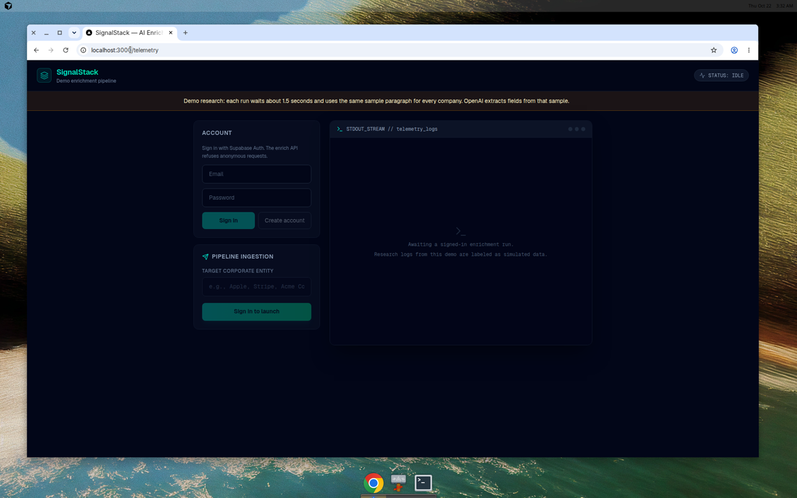

# SignalStack

**B2B lead enrichment demo with real-time observability** — sign in, submit a company name, and watch a pipeline stream step logs to a telemetry dashboard.

Company research in this project is **simulated**. Every company receives the same sample paragraph after a short wait. OpenAI then extracts fields from that sample. The app does not scrape the web, and it does not produce a confidence score.

[](https://signalstack-pearl.vercel.app/telemetry)
[](https://nextjs.org/)
[](https://www.typescriptlang.org/)
[](https://supabase.com/)
[](https://openai.com/)

**Live demo:** [signalstack-pearl.vercel.app/telemetry](https://signalstack-pearl.vercel.app/telemetry)

---

## At a glance

| | |
|---|---|
| **Problem** | Sales teams spend hours manually researching prospects before outreach. |
| **Solution** | A signed-in async pipeline that runs a simulated research step, extracts structured signals from that sample with AI, scores the lead, and persists results — with full step-by-step visibility. |
| **Who it's for** | RevOps, SDR teams, and platform engineers exploring enrichment workflow patterns. |
| **Project type** | Portfolio demo — async API design, structured AI output, auth, and observability. The research step is sample data. |

---

## Screenshots

**Telemetry dashboard** — sign in, submit a company, and watch pipeline steps stream in:



The dashboard labels research as demo data. A signed-in user can start a run. Anonymous calls to `/api/enrich` are rejected.

---

## How it works

```
POST /api/enrich  { "company": "Acme Corp" }   # signed-in user required
        │
        ▼
  Ingestion (202 Accepted immediately)
        │
        ▼
  Background worker (Vercel waitUntil)
        │
        ├── Research   → demo only: fixed sample paragraph, ~1.5s wait
        ├── Extraction → OpenAI structured JSON from that sample
        ├── Scoring    → deterministic lead score (0–100) from the sample
        └── Persist    → upsert to Supabase as that user
        │
        ▼
  Telemetry logs written at every step → dashboard polls & displays
```

1. A signed-in user POSTs a company name to `/api/enrich`. The browser sends the Supabase session cookie. API clients send `Authorization: Bearer <access_token>`.
2. The API checks the Supabase Auth user, applies a per-user limit (5 runs every 10 minutes), creates a job row owned by that user, and returns `202 Accepted` with a `jobId`.
3. A background worker runs the pipeline via Vercel's `waitUntil`. Database writes use that same user access token, so Postgres row-level security applies.
4. Each step writes to `pipeline_telemetry`. The dashboard reads those rows with the signed-in user's session.

Example for an API client that already has a Supabase user access token:

```bash
curl -X POST https://signalstack-pearl.vercel.app/api/enrich \
  -H "Content-Type: application/json" \
  -H "Authorization: Bearer $SUPABASE_ACCESS_TOKEN" \
  -d '{"company": "Stripe"}'
```

A request without a valid user receives `401`. A user over the limit receives `429`.

---

## Tech stack

| Layer | Technology |
|---|---|
| Frontend | Next.js 16, React 19, TypeScript, Tailwind CSS 4 |
| Backend | Next.js Route Handlers, Vercel Functions (`waitUntil`) |
| Auth | Supabase Auth (cookie session in the browser, bearer token for API clients) |
| AI | OpenAI SDK — GPT-4o with JSON mode, called only after auth and the rate limit |
| Database | Supabase (PostgreSQL) with row-level security |
| Deployment | Vercel |

---

## What this demonstrates

Useful signals for engineering and platform hiring:

- **Non-blocking async APIs** — instant `202` response while long-running work continues in the background
- **Signed-in access and a basic per-user limit** — anonymous callers cannot spend the OpenAI key
- **Row-level security** — writes carry the user JWT. The service-role key is not used, and it is never exposed to the browser
- **Structured AI integration** — schema-enforced JSON extraction on the simulated research paragraph
- **Observability-first design** — every pipeline step timed, logged, and surfaced in a live UI
- **Explicit job state machine** — `pending → processing → completed | failed`
- **Per-user idempotent writes** — enriched leads upserted on `(user_id, company_name)`
- **Separation of concerns** — ingestion, queue orchestration, research, extraction, and scoring in dedicated modules

---

## Quick start

### Prerequisites

- Node.js 20+
- A [Supabase](https://supabase.com/) project with Email auth enabled
- An [OpenAI API key](https://platform.openai.com/)

### 1. Clone and install

```bash
git clone https://github.com/RichTravels/signalstack.git
cd signalstack
npm install
```

### 2. Configure environment

Create `.env.local` (this file is gitignored):

| Variable | Required | Description |
|---|---|---|
| `OPENAI_API_KEY` | Yes | Server-only OpenAI API key for the extraction step |
| `NEXT_PUBLIC_SUPABASE_URL` | Yes | Supabase project URL |
| `NEXT_PUBLIC_SUPABASE_ANON_KEY` | Yes | Supabase anon key, or set `NEXT_PUBLIC_SUPABASE_PUBLISHABLE_KEY` instead. This is the public key used by the browser and as the API `apikey`. It is not a service-role key. |

Do not put a service-role or secret key in any `NEXT_PUBLIC_` variable. The enrich route does not read a service-role key. Writes go through the signed-in user's access token.

### 3. Set up the database

In the Supabase SQL editor, run:

[`supabase/migrations/20261022040000_user_scoped_rls.sql`](supabase/migrations/20261022040000_user_scoped_rls.sql)

That script creates the job, telemetry, and lead tables if they are missing, adds `user_id`, turns on row-level security, and grants access only to the `authenticated` role. Each user can read and write their own rows. The `anon` role has no grants on these tables.

Keep RLS enabled. The enrich API will fail closed if `user_id` or the policies are missing, and it will not call OpenAI until the signed-in user is under the rate limit.

In Supabase Auth, enable email sign-up so the dashboard's create-account form can issue a session. If email confirmations are on, confirm the message before signing in.

### 4. Run locally

```bash
npm run dev
```

Open [http://localhost:3000/telemetry](http://localhost:3000/telemetry), sign in, enter a company name, and watch the pipeline execute. The research lines in the log are demo data.

---

## Deployment (Vercel)

1. Push the repo to GitHub and import it in [Vercel](https://vercel.com/new).
2. Add `OPENAI_API_KEY`, `NEXT_PUBLIC_SUPABASE_URL`, and the public Supabase key from the table above. Do not add a service-role key as a public variable.
3. Deploy — the live app runs at `/telemetry`; the API is at `/api/enrich`.
4. Run the SQL migration on the production database.

The enrich route sets `maxDuration = 60` so the background pipeline can finish inside Vercel's function window.

---

## Project structure

```
signalstack/
├── src/
│   ├── app/
│   │   ├── api/enrich/route.ts   # Signed-in ingestion (202 + waitUntil)
│   │   ├── telemetry/page.tsx    # Live dashboard and sign-in
│   │   └── page.tsx              # Redirects to /telemetry
│   ├── services/
│   │   ├── queue.ts              # Pipeline orchestrator
│   │   ├── research.ts           # Simulated company research step
│   │   ├── extraction.ts         # OpenAI structured extraction
│   │   └── scoring.ts            # Lead scoring logic
│   ├── lib/
│   │   ├── auth.ts               # User JWT for RLS writes
│   │   ├── rate-limit.ts         # Per-user limit
│   │   ├── supabase/             # Browser, server, and proxy clients
│   │   └── openai.ts             # OpenAI client
│   └── proxy.ts                  # Refreshes the Supabase Auth session
├── supabase/migrations/          # RLS and per-user schema
├── public/screenshots/           # README preview image
└── README.md
```

---

## Engineering notes

### Research step (demo)

The research step waits 1.5 seconds and returns one fixed sample paragraph for every company. Telemetry logs and the dashboard banner say so. Scoring is a deterministic function of the tech tags extracted from that sample. `confidence_percentage` is stored as null. Replacing this with a real data source (web retrieval, Clearbit, Apollo, and so on) is future work. Extraction still calls OpenAI, which is why the route requires a signed-in user and a rate limit.

### Auth and database writes

Supabase Auth is the app's sign-in. The browser client keeps the session in cookies. `/api/enrich` calls `getUser()` and rejects the request when that fails. Pipeline writes use a server client that sends the user's access token with the public API key. Row-level security policies in the migration restrict each table to `auth.uid()`. There is no service-role client in this repo.

The in-memory limiter and a count of that user's recent `enrichment_jobs` rows together cap each account at 5 runs per 10 minutes. The database count is what holds across server instances.

### Polling vs. WebSockets

The dashboard polls Supabase every 1.5s rather than using WebSockets or SSE. This keeps the stack simple and is adequate for low-volume telemetry. SSE or Supabase Realtime would be the natural next step for lower latency.

### Error handling

Pipeline failures mark the job as `failed` and write a `CRITICAL` telemetry entry so the UI stops spinning. OpenAI and JSON parsing errors are caught per-step with structured error logs.

---

## Roadmap (production gaps)

Items that would move this from portfolio demo to production-ready:

- [ ] Real company data source (replace the simulated research sample)
- [ ] Supabase CLI migration workflow against a linked project
- [x] CI pipeline (lint, typecheck, build on PR)
- [x] API authentication and per-user rate limiting
- [ ] Unit/integration tests for scoring and extraction
- [ ] Supabase Realtime or SSE for live telemetry
- [ ] GitHub repo description/topics

---

## About

Built by [Rich Travels](https://github.com/RichTravels) to explore production-style patterns: async job queues, AI orchestration, telemetry, and resilient serverless execution.

**Repo:** [github.com/RichTravels/signalstack](https://github.com/RichTravels/signalstack)
